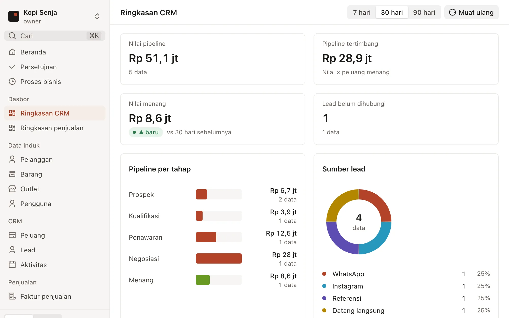

<p align="center">
  <a href="https://rangka-os.github.io/rangka-os/">
    <picture>
      <source media="(prefers-color-scheme: dark)" srcset="website/public/brand/rangka-horizontal-reversed.svg">
      
    </picture>
  </a>
</p>

<p align="center">
  <strong>The business OS your AI can safely change.</strong><br>
  Business apps as readable <code>.rk</code> files, served by one Go binary and one Postgres,
  changed through reviewed change sets.
</p>

<p align="center">
  <a href="LICENSE"></a>
  <a href="https://github.com/rangka-os/rangka-os/releases"></a>
  <a href="https://www.npmjs.com/package/@rangka-os/cli"></a>
  <a href="https://github.com/rangka-os/rangka-os/actions/workflows/kernel.yml"></a>
  <a href="https://rangka-os.github.io/rangka-os/"></a>
</p>

<p align="center">
  <a href="https://rangka-os.github.io/rangka-os/guide/quick-start">Quick start</a> ·
  <a href="https://rangka-os.github.io/rangka-os/guide/what-is-rangka">Docs</a> ·
  <a href="https://rangka-os.github.io/rangka-os/reference/">Reference</a> ·
  <a href="https://rangka-os.github.io/rangka-os/roadmap">Roadmap</a> ·
  <a href="docs/contracts/">Contracts</a>
</p>

<picture>
  <source media="(prefers-color-scheme: dark)" srcset="website/public/screens/dashboard-dark.webp">
  
</picture>

## What is Rangka OS?

Rangka OS is a source-available, declarative operating system for business apps (CRM, sales, invoicing, payments,
stock, POS), built first for Indonesian small and medium businesses.

Every module, model, rule, flow, dashboard, print format, theme and backend capability is a `.rk` file: strict YAML,
checked by JSON Schema. The kernel turns those files into Postgres tables, a REST + MCP API, realtime events and the
screens of the web app. A running installation changes only through **change sets**: proposed (by a person, the
Console or the Raka AI agent), validated on a copy, previewed with their SQL, approved by a person, applied live and
revertible. Money and stock never depend on an LLM.

> **Status: alpha (`v0.5.0-alpha`).** Rangka runs end to end, backs up and restores, enforces permissions and row
> scope per organisation and outlet, and is being readied for its first pilot businesses. It is not yet a stable
> release. See [Status](#status).

## Features

- **Apps as files.** Modules hold models, flows, roles, imports and print formats; apps compose modules into what a
  business uses, with dashboards and processes ([contract 0001](docs/contracts/0001-modules-and-apps.md)). An
  organisation's own fields and rules are overlays in `custom/<model>.rk`, never edits to the app.
- **Documents that behave.** Draft → submitted → cancelled, with amend; numbering at submit with per-organisation
  series; approvals; rupiah as integers (no floats), PPN 12% on DPP 11/12; declared stock moves with recipes and
  returns; recurring documents.
- **Work screens for staff.** Screens declared in `.rk` for the people at the counter or in the field, starting with
  the POS counter: cart, hold, split tender, sessions with a blind close, receipts, stock per outlet; an offline outbox
  with idempotency keys ([contract 0030](docs/contracts/0030-work-screens.md)).
- **Generated everything.** Tables and safe migrations (`--dry-run`, `--rollback`, destructive steps refused unless
  allowed), REST (`/api/v1`), SSE events, MCP tools, list aggregates, dashboards, PDF print formats, spreadsheet
  imports, CSV export, attachments, plan limits. Every screen works from phone to desktop.
- **Change sets.** Propose → validate → preview → approve → apply → revert. High-risk changes need the owner; an AI
  token can never approve or apply.
- **Raka in the app.** The Rangka AI agent answers in the web app and Console through a sidecar
  ([contract 0020](docs/contracts/0020-ai-assistant-relay.md)) and changes things only by proposing change sets.
  [`skills/`](skills) gives Raka and any other agent harness the same Rangka skills
  ([contract 0035](docs/contracts/0035-raka-skills.md)).
- **Rangka ID built in.** Password sign-in (bcrypt), sessions, API tokens, an OpenID Connect provider, roles with
  outlet scope and Postgres row-level security per organisation.
- **One binary.** Queue, scheduler, realtime, cache and files run on Postgres and the local disk by default;
  `system.rk` decides the drivers. `rangka backup` / `rangka restore` archive the database, metadata and uploads.
- **A strict validator, twice.** The Go kernel and the Python reference (`tools/rangka_validate.py`) print
  byte-identical reports: 107 codes, each with `file:line:col`.

## Quick start

### Start a project with npm

Needs Node.js 18+ and Docker (for Postgres), or a Postgres 16 of your own. Releases are pre-releases on the `next`
tag for now.

```bash
npm create @rangka-os@next my-shop     # asks for the business name, template demo or blank
cd my-shop
npm install                            # installs the rangka binary for your platform
npm run db                             # Postgres 16 in Docker on port 54329
npm run setup                          # validate, migrate, seed
npm run dev                            # http://localhost:8080/app/
```

The CLI on its own: `npx @rangka-os/cli@next validate --apps apps --site site`.

### Run the container

```bash
docker run --rm -p 8080:8080 -v "$PWD:/srv" -e DATABASE_URL=postgres://… ghcr.io/rangka-os/rangka:0.5.0-alpha.5 serve
```

Pre-releases are tagged by version only; `:latest` follows the first stable release.

`/srv` is a project folder as written by `npm create @rangka-os`. A production compose file (Postgres, Caddy,
backups, systemd) with a runbook lives in [`deploy/juragan/`](deploy/juragan/RUNBOOK.md).

### Build from source

Needs Go 1.24+ and PostgreSQL 16 server binaries (`scripts/pgtemp.sh` finds Homebrew, DBngin, Postgres.app and Debian
installs, or set `PGBIN`).

```bash
mkdir rangka && cd rangka
git clone git@github.com:rangka-os/rangka-os.git
git clone git@github.com:rangka-os/rangka-connectors.git
git clone git@github.com:rangka-os/rangka-ai.git          # optional: Raka answers in the demo when built

cd rangka-os/kernel
make run-demo                  # throwaway Postgres → migrate → seed → serve on :8080; Ctrl-C cleans up
make run-demo ADDR=:8090       # when 8080 is taken
```

| URL | What |
| --- | --- |
| http://localhost:8080/app/ | The web app: dashboards, lists, forms, approvals, imports, print |
| http://localhost:8080/console/ | Rangka Console for operators (demo sign-in `ceo@saga.co.id` / `rangka-demo`) |
| http://localhost:8080/api/v1/meta | Metadata API |
| `POST http://localhost:8080/mcp` | MCP endpoint for AI clients |

`make run-demo` serves with `--dev-open` (API without sign-in, as the owner). Never use that flag on a real server.

Other commands, from `kernel/`:

```bash
make test-unit        # go test without a database
make test             # every package against a throwaway Postgres
make validate         # validate the catalogue, sites and connectors
make compare-python   # Go and Python validators must print identical reports
```

Every `rangka` setting can come from flags, the environment or a `.env` file in the current directory
(`DATABASE_URL`, `RANGKA_APPS`, `RANGKA_SITE`, `RANGKA_ORG`, `RANGKA_OWNER_EMAIL`, …). See the
[CLI reference](https://rangka-os.github.io/rangka-os/reference/cli).

## How it fits together

```
 6  Presentation    themes/*.rk · layouts/*.rk · print formats       ← owners, Raka (low risk)
 5  Apps            modules/<m>/… · apps/<app>/{app,dashboards,processes}.rk   ← module and app authors
 4  Organisation    config.rk · features.rk · custom/<model>.rk overlays       ← owners, Raka
 3  Integrations    rangka-connectors/<c>/connector.rk               ← admin
 2  Capabilities    system.rk: db · cache · queue · scheduler · realtime · files · search · notify · auth
 1  Kernel          this repo: rangka validate · migrate · seed · serve · backup · restore (Go)
 0  Deploy          npm · Docker · compose · desktop · partner one-click · Rangka Cloud
```

An installation is a **site** folder (`system.rk`, `features.rk`, `config.rk`, `themes/`, `layouts/`, `custom/`)
plus the modules, apps and connectors it uses. A model in one file:

```yaml
# yaml-language-server: $schema=https://rangka-os.github.io/rangka-os/schema/0.5/model.json
name: deal
label: {id: Peluang, en: Deal}
realtime: true
fields:
  - {name: customer, type: link, to: customer, required: true}
  - name: stage
    type: select
    options:
      - {value: prospect, label: {id: Prospek}, probability: 10}
      - {value: won, label: {id: Menang}, probability: 100, tone: ok}
  - {name: value, type: currency}
  - {name: weighted_value, type: currency, compute: round(value * option('stage', 'probability') / 100)}
views:
  kanban: {group_by: stage, sum: value}
```

Read more: [architecture and layers](https://rangka-os.github.io/rangka-os/guide/architecture),
[`.rk` files](https://rangka-os.github.io/rangka-os/guide/rk-files),
[change sets](https://rangka-os.github.io/rangka-os/concepts/change-sets).

## Repository layout

| Path | What |
| --- | --- |
| [`kernel/`](kernel/README.md) | Go kernel: `.rk` loader and validator, migrations, CEL, document lifecycle, REST, SSE, MCP, queue and scheduler, Rangka ID, change sets, files, imports, print, backup |
| [`schema/0.5/`](schema/0.5) | JSON Schemas for every `.rk` kind (module, model, flow, app, dashboard, print, import, system, config, …). `schema/0.4/` stays published for older files |
| [`tools/`](tools) | Python reference validator `rangka_validate.py`, strict `.rk` reader `rkfile.py`, converters and doc builders |
| [`templates/`](templates) | Theme and layout templates |
| [`skills/`](skills/README.md) | Skills for AI agents (Agent Skills format, contract 0035). Claude Code: `/plugin marketplace add rangka-os/rangka-os`, then `/plugin install rangka-skills@rangka-os`; any harness: `rangka skills install`. [Docs](https://rangka-os.github.io/rangka-os/skills/) |
| [`web/app/`](web/app) | The web app served at `/app/` |
| [`web/console/`](web/console/README.md) | Rangka Console, the control pane for operators |
| [`web/design-system/`](web/design-system) | React components and `tokens.json` (Ink, Bata, warm stone; light and dark) |
| [`website/`](website) | This documentation site (VitePress), published to GitHub Pages |
| [`npm/`](npm) | `@rangka-os/cli` and `@rangka-os/create` |
| [`deploy/`](deploy) | Container image and the production compose setup |
| [`docs/contracts/`](docs/contracts) | Contracts: how cross-repo formats and APIs change ([0000](docs/contracts/0000-how-contracts-change.md)) |

## The Rangka family

| Repo | What | Licence |
| --- | --- | --- |
| **[rangka-os](https://github.com/rangka-os/rangka-os)** (this repo) | Kernel, schemas, validators, web app, Console, design system, docs | ELv2 |
| [rangka-apps](https://github.com/rangka-os/rangka-apps) | Modules and apps (CRM, sales, invoicing, payments, stock, …), example sites | ELv2 |
| [rangka-connectors](https://github.com/rangka-os/rangka-connectors) | Integrations as `connector.rk` (WhatsApp Business first) | ELv2 |
| [rangka-ai](https://github.com/rangka-os/rangka-ai) | Raka, the AI agent: guardrails in code, works only through change sets | ELv2 |
| [rangka-edge](https://github.com/rangka-os/rangka-edge) | Outlet device agent: printers, scanners, cash drawers; offline first | ELv2 |
| rangka-cloud | Managed hosting, chat onboarding, billing | private |

## Status

Done and tested on Postgres 16: validators, migrations with dry run and rollback, document lifecycle, numbering,
approvals, multi-organisation with row scope and RLS, permissions, attachments, imports, CSV export, print formats,
list aggregates, dashboards, declared stock moves, recurring documents, plan limits, change sets, Rangka ID + OIDC,
MCP and skills, backup and restore, the responsive web app and Console, the POS counter work screen, the Raka relay,
releases on npm, GitHub and ghcr.io.

Still open: the CEL engine, YAML reader, JSON Schema validator, HTTP router and job queue are small in-tree packages
to be swapped for the upstream libraries ([contract 0005 §1](docs/contracts/0005-pilot-readiness.md)); the connector
runtime ([0002](docs/contracts/0002-connector-runtime-and-ports.md)) and connector secrets
([0017](docs/contracts/0017-connector-secrets.md)); sending email, push and WhatsApp (logged only); Valkey and S3
drivers; edge sync ([0006](docs/contracts/0006-edge-sync.md)). The [roadmap](https://rangka-os.github.io/rangka-os/roadmap)
has the full list.

## Contributing

Issues and pull requests are welcome; read the
[contributing guide](https://rangka-os.github.io/rangka-os/contributing) first. In short:

- `make test`, `make validate` and `make compare-python` pass before a PR.
- A change to `.rk` semantics lands in both validators and in a contract under [`docs/contracts/`](docs/contracts).
  Changes that cross repos start as a contract proposal.
- Code, comments and docs are English. UI text is Bahasa Indonesia first: sentence case, "kamu", `Rp 1.250.000`,
  `27 Okt 2026`.
- Contributions need a contributor agreement (to be published).

## Security

Please do not open a public issue for a vulnerability. See [SECURITY.md](SECURITY.md).

## Licence

Rangka OS is **source-available** under the [Elastic License 2.0 (ELv2)](LICENSE), copyright 2026 Saga Tekno Studio.
You may use, copy, change and self-host it, including for your own business. You may not offer it to others as a
hosted or managed service, or remove or work around its licence notices. Partners who want to host Rangka for clients
need a partner agreement with Saga Tekno Studio. Rangka Cloud is the only closed part of the family.
